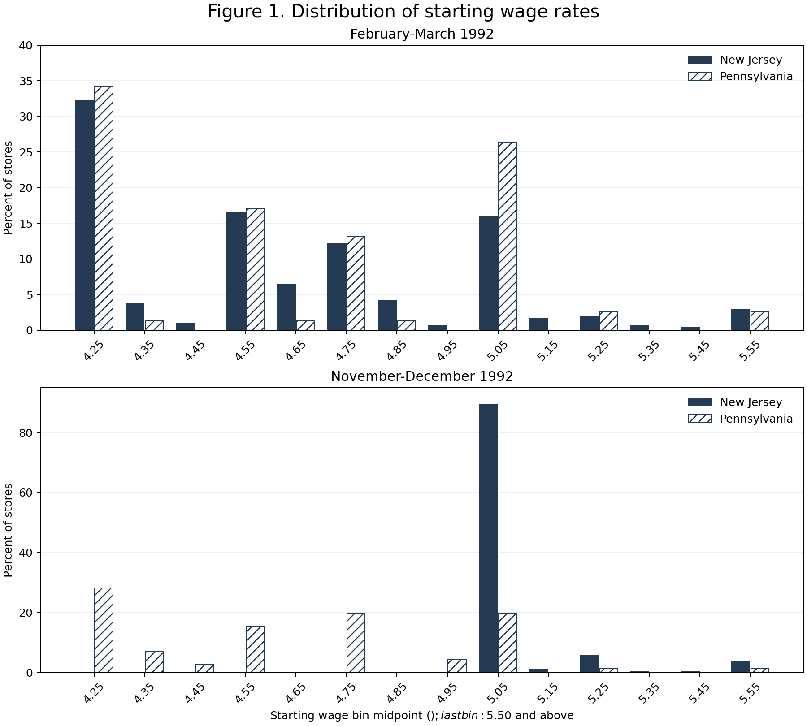
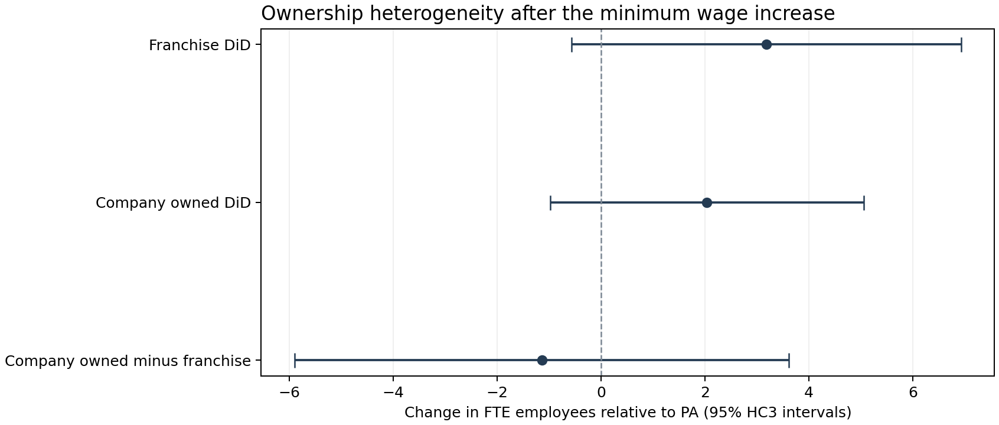

# Minimum Wage and Employment in Fast Food Restaurants

Replication of Card and Krueger 1994 and an ownership heterogeneity extension

Rui YUAN | Student ID 3036760840 | ECO6067 | 13 October 2026

## Abstract

This project reproduces the assigned descriptive statistics, employment comparisons, reduced-form regressions and starting-wage distributions from Card and Krueger (1994). The input contains 410 fast-food restaurants in New Jersey and Pennsylvania surveyed around New Jersey's 1992 minimum-wage increase. In the 384-store paired employment sample, the difference-in-differences estimate is 2.75 full-time-equivalent employees, with a standard error of 1.34. The 357-store wage-screened regressions reproduce all five published treatment coefficients and their standard errors to displayed precision under the documented author-code interpretation. Some other printed entries remain unmatched, including unbalanced-sample standard errors and internally inconsistent model-v diagnostics. An independent extension tests whether the employment comparison differs by ownership. With chain controls, the company-owned-minus-franchise difference is -1.14 FTE, with a 95% HC3 interval of [-5.90, 3.62] and p = 0.637. Its sign changes when baseline employment is controlled. The sample does not provide precise evidence of ownership heterogeneity; this is not evidence of equivalence. A documented pipeline regenerates the results and this report from the input CSV.

## 1 Research question and motivation

Card and Krueger (1994) ask whether a higher minimum wage reduces employment in fast-food restaurants. On April 1, 1992, New Jersey increased its minimum wage from $4.25 to $5.05, while Pennsylvania retained $4.25. In a competitive labor-demand framework, a binding wage floor can reduce demand for labor. The paper uses the policy difference across neighboring areas to evaluate this prediction empirically, rather than assuming the sign of the response.

The original comparison is valuable because employment can change during a recession even without a policy change. A before-and-after comparison in New Jersey alone would mix policy effects with these changes. Comparing its employment change with eastern Pennsylvania attempts to remove common changes. This project first reconstructs the assigned results, then asks whether organizational form is associated with a different response. Ownership is recorded before the follow-up survey and is already available in the original data.

### 1 1 Data provenance and sample

The main input is the course Package 01 public.csv, with 410 observations and 46 original fields. I also obtained David Card's public archive independently for source verification: every numeric value and missing entry in its public.dat equals the course CSV. The original paper and public codebook were inspected. The primary input remains the documented course CSV; independent source verification is not presented as a different dataset or as WRDS data collection.

---

## 2 Data construction and empirical design

The sample covers Burger King, KFC, Roy Rogers and Wendy's. The baseline survey took place in February-March 1992 and follow-up in November-December 1992. New Jersey has 331 sampled restaurants and Pennsylvania 79. Variable-specific missing observations are retained in the master file and excluded only from the statistic that requires them. SHEET 407 occurs in both states for different restaurants, so the working identifier combines STATE and SHEET.

FTE = EMPFT + NMGRS + 0.5 x EMPPT. Managers receive full weight, and a missing component is not treated as zero. Six permanently closed restaurants have zero follow-up employment. Four temporary closures have missing baseline-specification follow-up employment; only the designated alternative in Table 3 sets them to zero. Full-time percentage is 100 x EMPFT/FTE, as in the author's SAS program. Meal price sums soda, fries and entree only when all three are observed. Prices already include tax.

### Sample accounting

| Sample | NJ | PA | Total |
| --- | --- | --- | --- |
| Original stores | 331 | 79 | 410 |
| Observed baseline FTE | 321 | 77 | 398 |
| Observed follow-up FTE | 319 | 77 | 396 |
| Paired employment sample | 309 | 75 | 384 |
| Paired sample with temporary closures zero | 313 | 75 | 388 |
| Table 4 wage-screened sample | 290 | 67 | 357 |
| Permanent closures | 5 | 1 | 6 |
| Temporary closures | 4 | 0 | 4 |

Table 4 requires employment in both waves and starting wages in both waves, with a permanent-closure exception for the follow-up wage. It retains 357 stores, including all six permanent closures. Mean employment change is -0.237535 and its sample SD is 8.825485, matching the published sample description. The ownership extension instead uses all 384 paired employment observations and does not screen on follow-up wages.

### Identification and estimands

DiD = (mean FTE after - mean FTE before in NJ) - (mean FTE after - mean FTE before in PA). For a causal interpretation, untreated employment changes must be comparable across the two states, with no confounding differential shock, relevant spillover or selection change. The sample has one pre-policy survey, so a pre-trend test is not available. Results concern initially sampled restaurants, not employment created through new restaurant entry.

The regression outcome is store-level change in FTE. GAP equals max[(5.05 - baseline wage)/baseline wage, 0] in NJ and zero in PA. NJ/GAP models have an intercept; additional specifications include chain indicators, ownership and regions. Historical table replication uses conventional OLS errors. The extension uses HC3 errors with residual-degree-of-freedom t intervals. These errors address restaurant-level heteroskedasticity, not arbitrary state-level policy shocks.

---

## 3 Core replication results

### 3 1 Means of key variables

### Table 2  Means of key variables

| Part | Variable | NJ | PA | t NJ minus PA |
| --- | --- | --- | --- | --- |
| 1 | Burger King | 41.1 | 44.3 | -0.5 |
| 1 | KFC | 20.5 | 15.2 | 1.2 |
| 1 | Roy Rogers | 24.8 | 21.5 | 0.6 |
| 1 | Wendy's | 13.6 | 19.0 | -1.1 |
| 1 | Company-owned | 34.1 | 35.4 | -0.2 |
| 2 | FTE employment | 20.4 (0.51) | 23.3 (1.35) | -2.0 |
| 2 | Percentage full-time employees | 32.8 (1.3) | 35.0 (2.7) | -0.7 |
| 2 | Starting wage | 4.61 (0.02) | 4.63 (0.04) | -0.4 |
| 2 | Wage = 4.25 (percentage) | 30.5 (2.5) | 32.9 (5.3) | -0.4 |
| 2 | Price of full meal | 3.35 (0.04) | 3.04 (0.07) | 4.0 |
| 2 | Hours open (weekday) | 14.4 (0.2) | 14.5 (0.3) | -0.3 |
| 2 | Recruiting bonus | 23.6 (2.3) | 29.1 (5.1) | -1.0 |
| 3 | FTE employment | 21.0 (0.52) | 21.2 (0.94) | -0.1 |
| 3 | Percentage full-time employees | 35.9 (1.4) | 30.4 (2.8) | 1.8 |
| 3 | Starting wage | 5.08 (0.01) | 4.62 (0.04) | 10.8 |
| 3 | Wage = 4.25 (percentage) | 0.0 (0.0) | 25.3 (4.9) | -5.1 |
| 3 | Wage = 5.05 (percentage) | 85.5 (1.9) | 1.3 (1.3) | 36.4 |
| 3 | Price of full meal | 3.41 (0.04) | 3.03 (0.07) | 5.1 |
| 3 | Hours open (weekday) | 14.4 (0.2) | 14.7 (0.3) | -0.6 |
| 3 | Recruiting bonus | 20.3 (2.3) | 23.4 (4.9) | -0.6 |

Part 1: store type percentages; part 2: baseline; part 3: follow-up. Parentheses contain sample mean standard errors. Employment is FTE, wages and meal prices are dollars, and bonus/wage-point indicators are percentages. NJ-minus-PA t uses separate group variances. The script also computes t where the original displays a dash. Variable-specific denominators are in table_2.csv.

Wage-point percentages use all sampled stores in each state as the denominator, consistent with the author's equality indicators, while wage means use observed wages. NJ's baseline $4.25 count is 101: 101/331 = 30.5%, compared with 101/314 = 32.2% among nonmissing wages. The follow-up $5.05 count is 283 in the supplied and author data, giving 85.5%, versus 85.2% printed. Excluding a reported wage at one renovation closure would explain this count difference, but is not an established original rule and is not imposed here.

---

## 3 2 Employment levels and changes

### Table 3  Average employment before and after

| Row | PA | NJ | NJ minus PA | NJ low | NJ mid | NJ high | Low minus high | Mid minus high |
| --- | --- | --- | --- | --- | --- | --- | --- | --- |
| 1 Before | 23.33 (1.35) | 20.44 (0.51) | -2.89 (1.44) | 19.56 (0.77) | 20.08 (0.84) | 22.25 (1.14) | -2.69 (1.37) | -2.17 (1.41) |
| 2 After | 21.17 (0.94) | 21.03 (0.52) | -0.14 (1.08) | 20.88 (1.01) | 20.96 (0.76) | 20.21 (1.03) | 0.66 (1.44) | 0.74 (1.27) |
| 3 Separate means change | -2.17 (1.22) | 0.59 (0.47) | 2.75 (1.31) | 1.32 (0.81) | 0.87 (0.67) | -2.04 (0.98) | 3.36 (1.27) | 2.91 (1.19) |
| 4 Paired change | -2.28 (1.25) | 0.47 (0.48) | 2.75 (1.34) | 1.20 (0.82) | 0.71 (0.69) | -2.16 (1.01) | 3.36 (1.30) | 2.87 (1.22) |
| 5 Temporary closures zero | -2.28 (1.25) | 0.23 (0.49) | 2.51 (1.35) | 0.90 (0.87) | 0.49 (0.69) | -2.39 (1.02) | 3.29 (1.34) | 2.88 (1.23) |

Parentheses contain standard errors. Low/mid/high NJ groups have baseline wages of $4.25 / $4.26-$4.99 / at least $5.00. Group membership counts are 101 / 140 / 73, but each employment mean has its own observed count. All contrasts are computed from unrounded inputs.

The paired comparison reproduces 2.75 FTE (SE 1.34). PA paired stores lose 2.28 FTE on average while NJ paired stores gain 0.47. Setting temporary-closure employment to zero lowers the DiD to 2.51 (SE 1.35). This accounting choice is economically meaningful because a closed store still belongs to the original cohort. It does not overturn the relative employment pattern in these data.

The initial low-wage versus high-wage NJ comparison also reproduces the paper's qualitative pattern: the low-wage group has a larger employment increase. This is part of the assigned replication, not the independent extension. High baseline wages can reflect different restaurant characteristics, so the contrast is not automatically an experiment within NJ.

### Unbalanced change standard errors

Row 3 subtracts separate-wave means, rather than averaging only paired changes. Its sampling variance depends on within-store covariance and which observations are present in each wave. The publication does not specify enough detail to recover all its row-3 errors, and the public SAS summarizes only part of Table 3. I use a store-level influence-function estimator, allowing the two observed samples to differ:

z_i = I(after observed) x (after_i - mean_after)/n_after - I(before observed) x (before_i - mean_before)/n_before; SE = sqrt{N/(N-1) x sum_i z_i squared}. Missing contributions are zero; N is the original store count in the group.

This gives row-3 NJ SE = 0.47215 versus printed 0.54, and PA SE = 1.22199 versus 1.25. The row-3 between-state SE is 1.31003 versus 1.36. These are disclosed alternative variance estimates, not exact reproduction. Several other point estimates differ by roughly 0.005-0.008 FTE at the final displayed digit. No computed result is replaced with a copied paper value. Appendix A lists every comparison outside the published rounding interval.

---

## 3 3 Reduced form employment regressions

### Table 4  Change in FTE employment

| Independent variable or statistic | i | ii | iii | iv | v |
| --- | --- | --- | --- | --- | --- |
| NJ indicator | 2.33 (1.19) | 2.30 (1.20) | - | - | - |
| Initial wage GAP | - | - | 15.65 (6.08) | 14.92 (6.21) | 11.91 (7.39) |
| Chain controls | No | Yes | No | Yes | Yes |
| Ownership control | No | Yes | No | Yes | No |
| Region controls | No | No | No | No | Yes |
| Residual standard error | 8.79 | 8.78 | 8.76 | 8.76 | 8.74 |
| Joint controls F test p | - | 0.34 | - | 0.44 | 0.31 |
| Observations | 357 | 357 | 357 | 357 | 357 |

All models include an intercept. Standard errors in parentheses are conventional OLS errors. Model v follows the author's public SAS implementation; its ownership setting differs from the combined control label in the printed paper. Chain and region reference categories do not affect fitted treatment coefficients. The joint test excludes NJ/GAP and the intercept.

Models i-iv reproduce the displayed treatment coefficients, standard errors and reported controls diagnostics. The simple state coefficient is 2.3258 with SE 1.1916. Its 95% interval is [-0.0176, 4.6693], so the positive estimate should not be described as conclusive evidence of an employment increase at the two-sided 5% level. GAP is positively associated with employment change in models iii and iv. Because GAP is a proportion, its coefficient is not an effect per dollar of wages.

### Source inconsistency in model v

The printed table says chain and ownership controls are included. The public author command for the level-change model contains GAP, three chain indicators, CENTRALJ, SOUTHJ, PA1 and PA2, omitting CO_OWNED. That command gives GAP = 11.9131 and SE = 7.3944, matching printed 11.91 (7.39), but residual SE = 8.7402 and joint-controls p = 0.3075, rather than printed 8.75 and 0.40.

Adding ownership instead gives GAP = 11.9792 (SE 7.4191), residual SE = 8.7525 and joint-controls p = 0.4046. Thus two coherent specifications align with different parts of the printed column. The principal replication follows the author command and preserves the alternative in table_4_model_v_label_audit.csv. It does not combine a coefficient from one regression with diagnostics from another. The archive accompanies the survey data used in Myth and Measurement and is a primary implementation cross-check, not proof of the exact AER production program.

Across Tables 2-4, 164 of 186 transcribed numeric entries fall in their printed rounding intervals. This count includes coefficients, means, errors, contrasts and diagnostics; it is an audit measure, not an estimate of scientific validity. Remaining differences are not all attributed to rounding.

---

## 3 4 Starting wage distributions

Figure 1  Distribution of starting wages by state and survey wave. Each state-wave denominator is its number of observed wages. Bars use half-open ten-cent bins from [4.20, 4.30) through [5.40, 5.50), with wages at least $5.50 pooled in the last bar. Integer cents avoid floating-point boundary errors.

The broad original pattern is reproduced: before the policy, both states have substantial mass near $4.25 and other wage points; after the policy, NJ wages concentrate near $5.05 while PA retains a wider distribution including the old minimum. The original figure does not document exact bin edges or tail treatment, so bar-for-bar identity is not claimed. All nonmissing wages are included, and percentages sum to 100 within every state-wave group. Underlying counts are supplied in figure_1_bins.csv.

---

## 4 Independent extension on restaurant ownership

### 4 1 Economic question and design

Does the NJ-versus-PA employment change differ between company-owned restaurants and franchise restaurants? Ownership could matter if corporate stores can share resources across outlets or implement common staffing policies, while franchise operators make more local decisions. Conversely, centralized cost control could produce larger corporate staffing reductions. These are competing hypotheses, not mechanisms established by these data. A two-sided ownership interaction is therefore the primary test.

The extension goes beyond including ownership as a common control in the original regressions. It allows the NJ employment comparison itself to differ by ownership. Let O_i denote company ownership. The primary model is:

Change in FTE_i = a + b x NJ_i + c x O_i + d x (NJ_i x O_i) + chain controls + error_i.

Here b is the franchise NJ-minus-PA change, b+d is the company-owned change, and d is the difference between those two comparisons. In an equivalent two-period level model, d corresponds to the NJ x post x ownership interaction, with the required lower-order terms. Ownership is held at its recorded store characteristic. The model uses 384 paired employment stores and three chain indicators; no follow-up wage filter or outcome-driven subgroup threshold is introduced.

### Table 5  Paired sample by state and ownership

| State | Ownership | N | Before FTE | After FTE | Change FTE | Baseline wage |
| --- | --- | --- | --- | --- | --- | --- |
| PA | Franchise | 49 | 26.01 | 23.60 | -2.41 | 4.51 |
| PA | Company owned | 26 | 18.43 | 16.38 | -2.05 | 4.86 |
| NJ | Franchise | 201 | 20.83 | 21.56 | 0.72 | 4.59 |
| NJ | Company owned | 108 | 19.68 | 19.67 | -0.01 | 4.64 |

The PA company-owned comparison group has only 26 stores. Baseline composition differs: PA franchises average 26.01 FTE and $4.51 in wages, while PA corporate stores average 18.43 FTE and $4.86 among observed wages. These differences motivate sensitivity checks with baseline employment and wages, rather than interpreting ownership as randomly assigned. The paired observation rates also range from 92.2% to 96.1% across groups; detailed counts are in extension_composition.csv.

### Inference and identifying assumptions

The primary ownership-difference test uses HC3 heteroskedasticity-consistent covariance and residual-df t inference. HC3 adjusts squared residual contributions for observation leverage (MacKinnon and White, 1985; statsmodels documentation). The company-owned contrast uses the full covariance of b and d, not the sum of their SEs. The unadjusted interaction is independently checked against the four-cell difference, and the HC3 matrix is checked against a direct sandwich calculation.

A causal ownership contrast requires comparable untreated NJ-minus-PA trends across ownership types, and no ownership-specific confounding shock. With two states and one pre-period these assumptions cannot be verified. State-cluster inference with only two clusters would not solve this problem. The reported HC3 intervals are conditional restaurant-level uncertainty and may understate uncertainty from common state shocks.

---

## 4 2 Extension estimates

### Table 6  Primary ownership contrasts

| Contrast | Estimate | HC3 SE | 95 percent interval | p value |
| --- | --- | --- | --- | --- |
| Franchise DiD | 3.18 | 1.91 | [-0.57, 6.93] | 0.096 |
| Company owned DiD | 2.04 | 1.53 | [-0.97, 5.05] | 0.184 |
| Ownership difference | -1.14 | 2.42 | [-5.90, 3.62] | 0.637 |

Sample N = 384; residual degrees of freedom = 377. All contrasts come from the same chain-controlled regression. The ownership difference is company-owned DiD minus franchise DiD. Full coefficients and conventional-OLS inference are in extension_coefficients.csv.

Figure 2  Estimated employment contrasts with 95% HC3 intervals. Zero is included in all three intervals.

The estimated franchise DiD is 3.18 FTE and the company-owned DiD 2.04. The difference is -1.14 FTE, SE 2.42, with p = 0.637 and interval [-5.90, 3.62]. The data therefore do not reject equal ownership-specific comparisons. They also allow economically meaningful differences in either direction. Failure to reject is not evidence that the effects are equal or that ownership is irrelevant.

The descriptive four-cell ownership difference without chain controls is -1.10 FTE. Its proximity to the primary estimate suggests that the chain controls alone do not explain the initial point estimate. However, ownership groups differ in initial employment and wages, and the next section shows that conditioning on those initial characteristics changes the direction of the estimated difference.

---

## 4 3 Sensitivity and limitations

### Table 7  Sensitivity of the ownership difference

| Specification | N | Difference | HC3 SE | 95 percent interval | p |
| --- | --- | --- | --- | --- | --- |
| No chain controls | 384 | -1.10 | 2.47 | [-5.96, 3.77] | 0.658 |
| Primary chain controls | 384 | -1.14 | 2.42 | [-5.90, 3.62] | 0.637 |
| Add baseline FTE | 384 | 1.51 | 1.78 | [-1.99, 5.00] | 0.396 |
| Add baseline FTE and wage | 365 | 1.78 | 1.86 | [-1.89, 5.44] | 0.341 |
| Exclude permanent closures | 378 | -0.73 | 2.43 | [-5.51, 4.05] | 0.764 |
| Temporary closures set to zero | 388 | -0.92 | 2.42 | [-5.68, 3.85] | 0.705 |

All rows estimate the same company-owned-minus-franchise contrast but differ in adjustment or sample. The baseline-wage specification uses 365 complete observations. Removing permanent closures leaves 378; adding temporary closures with zero employment gives 388. Results are sensitivity checks around one primary hypothesis, not separate discoveries.

Ownership differences range from -1.14 to +1.78 FTE across the six specifications, and every interval includes zero. Adding baseline employment changes the sign to +1.51; adding baseline employment and wages gives +1.78. These controls change the conditional comparison and can be sensitive to regression to the mean or measurement error, so they are not automatically superior causal estimates. The sign reversal does show that a claim that corporate stores responded less favorably is not stable to plausible adjustment.

Closure alternatives keep the difference negative but imprecise. No alternative establishes a statistically precise ownership gap. A positive company-owned contrast in one adjusted model is not evidence of a significant difference from franchises: the relevant interaction test remains nonsignificant. I therefore report the interaction directly instead of comparing separate subgroup significance stars.

### 5 Limitations and conclusion

Survey-based employment and wage reports can contain measurement error. Missingness can depend on store characteristics; paired comparisons exclude stores without observed changes, and different variable screens target different samples. Restaurants are not randomly assigned to ownership, baseline wage exposure differs, and the data do not observe corporate financial support, labor-demand shocks or staffing decisions. The proposed organizational channels cannot be distinguished directly. Only the sampled fast-food cohort in these areas is studied, so extrapolation to other industries, later periods or restaurant entry is not warranted.

The assigned core results broadly reproduce the original finding of no observed relative employment decline in NJ, while retaining transparent differences in printed statistics and one ambiguous model specification. The extension contributes a direct, economically motivated ownership comparison rather than more controls alone. Its main lesson is limited precision and sensitivity to baseline composition: this sample does not support a firm conclusion about ownership-specific responses. More pre-policy observations, additional policy comparisons and richer restaurant characteristics would be needed to strengthen that inference.

---

## 6 Reproducibility and AI disclosure

The repository contains an end-to-end Python workflow, dependency requirements, generated aggregate results, sample audits and the report source. With the documented public.csv input in 01_DID/data/, run.ps1 or src/run_all.py regenerates the core replication, ownership extension, validation outputs and report without editing data or code. Restricted course raw data, processed store-level data and local dependency files are ignored by Git; processed data are regenerated locally. Original papers and course download links are not redistributed. Git commits record meaningful stages rather than one final upload.

Validation checks dimensions and state counts, state/sheet keys, closure treatment and the regression sample. The paired DiD is independently recomputed with Welch inference and a two-period within-store regression. OLS coefficients are compared with NumPy least squares. Extension HC3 covariance is checked against its matrix formula, and the unadjusted ownership interaction against the four-cell identity. Every wage observation enters a bin and every state-wave percentage total is 100. Repeated pipeline outputs are checked for deterministic equality. These checks establish implementation consistency, not the causal assumptions.

Codex assisted with reading the brief and data dictionary, visually inspecting the scanned paper, locating the official archive, coding, calculations, documentation and report drafting. AI outputs were checked using the tests above and source comparisons. Corrected or rejected suggestions included using SHEET as a global identifier, a headcount-based full-time percentage, dropping permanent closures because follow-up wages are missing, and deleting reported operating variables solely to improve a match. The model-v source conflict and unmatched row-3 SEs were retained explicitly. The full disclosure in AI_USE.md separates assistant-performed checks from the student's responsibility for the final submission.

## References

Card, David, and Alan B. Krueger. 1994. Minimum Wages and Employment: A Case Study of the Fast-Food Industry in New Jersey and Pennsylvania. American Economic Review 84(4): 772-793.

Card, David. Available data sets, NJ-PA survey archive, codebook and check.sas. https://davidcard.berkeley.edu/data_sets.html. Accessed 13 October 2026. The archive README identifies its use in Myth and Measurement, chapter 2.

MacKinnon, James G., and Halbert White. 1985. Some Heteroskedasticity-Consistent Covariance Matrix Estimators with Improved Finite Sample Properties. Journal of Econometrics 29(3): 305-325. https://doi.org/10.1016/0304-4076(85)90158-7.

statsmodels. OLSResults.HC3_se documentation. https://www.statsmodels.org/stable/generated/statsmodels.regression.linear_model.OLSResults.HC3_se.html. Accessed 13 October 2026.

ECO6067. Individual Project: AI-Assisted Empirical Paper Replication and Extension. Draft v3, 2026. Course Package 01 README, data dictionary and public.csv.

---

## Appendix A Published entry discrepancies

### Entries outside the printed rounding interval

| Table | Row or variable | Column | Computed | Printed | Difference |
| --- | --- | --- | --- | --- | --- |
| T2 | Wave 2 FTE | t | -0.1283 | -0.20 | 0.0717 |
| T2 | Wave 2 wage 5.05 | NJ | 85.4985 | 85.20 | 0.2985 |
| T2 | Wave 2 wage 5.05 | t | 36.3848 | 36.10 | 0.2848 |
| T2 | Wave 2 wage 5.05 | NJ_se | 1.9383 | 2.00 | -0.0617 |
| T2 | Wave 2 meal | t | 5.0784 | 5.00 | 0.0784 |
| T2 | Wave 2 hours | t | -0.6492 | -0.80 | 0.1508 |
| T3 | 2 | NJ-PA_se | 1.0772 | 1.07 | 0.0072 |
| T3 | 2 | low-high | 0.6638 | 0.67 | -0.0062 |
| T3 | 2 | mid-high | 0.7418 | 0.75 | -0.0082 |
| T3 | 3 | PA | -2.1656 | -2.16 | -0.0056 |
| T3 | 3 | PA_se | 1.2220 | 1.25 | -0.0280 |
| T3 | 3 | NJ_se | 0.4721 | 0.54 | -0.0679 |
| T3 | 3 | NJ-PA | 2.7536 | 2.76 | -0.0064 |
| T3 | 3 | NJ-PA_se | 1.3100 | 1.36 | -0.0500 |
| T3 | 3 | low_se | 0.8116 | 0.95 | -0.1384 |
| T3 | 3 | mid_se | 0.6728 | 0.84 | -0.1672 |
| T3 | 3 | high_se | 0.9819 | 1.14 | -0.1581 |
| T3 | 3 | low-high_se | 1.2739 | 1.48 | -0.2061 |
| T3 | 3 | mid-high_se | 1.1903 | 1.41 | -0.2197 |
| T3 | 4 | low | 1.2048 | 1.21 | -0.0052 |
| T4 | 5 | residual_se | 8.7402 | 8.75 | -0.0098 |
| T4 | 5 | controls_p | 0.3075 | 0.40 | -0.0925 |

Comparison tolerance is half a unit in the last displayed decimal, with a numerical epsilon. The complete comparison.csv includes matches as well. Table 2 wage-point differences involve denominator and closure-reporting conventions; Table 3 row-3 errors use the disclosed influence estimator; model-v diagnostics involve the documented source conflict. Other small differences are retained without claiming a known cause.

Complete observed counts, all model coefficients, official-source verification hashes, validation checks and both model-v interpretations are available in results/. No published entry is substituted into the computed result tables.
